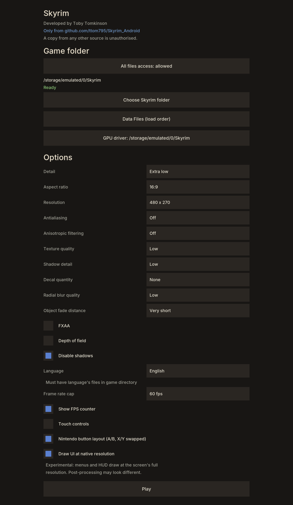

# The Elder Scrolls V: Skyrim (PC, 2011) for Android

An unofficial "native" Android port of the original 2011 PC version of *The Elder Scrolls V: Skyrim* (not Special Edition). It should run on any arm64 phone with Vulkan 1.1 and is tested on a Snapdragon device with an Adreno 610 GPU (Retroid Pocket Duo Lite, if anyone is curious).

This repository contains no game code or data. You need your own copy of the PC game, which is used as a basis for the recompilation. Personally, I used the Steam version.

Discord: http://discord.gg/df3cK2JCqs

Youtube link below:

[](https://www.youtube.com/watch?v=FxGzgauZbgU)

## Functionality
- **Static recompilation.** This project is *not* a decompilation but a recompilation; Basically, it's just converting one type of code to another rather than re-creating the original source. `TESV.exe`, `d3dx9_42.dll`, `binkw32.dll` and `X3DAudio1_7.dll` are all recompiled.
- **Multi-core:** the game's threads run on all cores, like on PC. ARM orders memory more loosely than x86, so the recompiler uses ARM's load-acquire/store-release instructions for shared memory to keep x86 behaviour.
- **Graphics:** a patched [dxvk-native](https://github.com/Joshua-Ashton/dxvk-native) (native-1.9.2b) translates D3D9 to Vulkan 1.1. You must meet this requirement for the game to even launch, but most devices support it nowadays.
- **Platform:** SDL2 2.30.9 is used for the window, input, audio and the Android activity. There is an optional on-screen overlay for phones without a controller. XAudio2 is reimplemented on top of SDL2.

## Port settings

The app opens on a launcher before the game starts:
- **Choose Skyrim folder**: where your game files are (see 3. Installing).
- **Detail**: Low, Medium, High or Ultra, like the PC launcher. Low is the default and is what an Adreno 610 can manage.
- **Resolution**: the screen's own resolution, or a lower one (down to 108p) that is stretched to fill the screen.
- **Antialiasing, Anisotropic filtering, Texture quality, Shadow detail, Decal quantity, Radial blur quality, Object fade distance, Vertical sync**: the same options as the PC launcher.
- **Touch controls**: show or hide the on-screen buttons.
- **Nintendo button layout**: swaps A/B and X/Y on physical controllers.

# Instructions

## Game files you need

Everything comes from your own PC install of *The Elder Scrolls V: Skyrim* (2011).

| For building on PC | For playing on Android
| :------------------ | -------------------:
| TESV.exe | TESV.exe
| d3dx9_42.dll (32-bit) | d3dx9_42.dll (32-bit)
| binkw32.dll | binkw32.dll
| X3DAudio1_7.dll (32-bit) | X3DAudio1_7.dll (32-bit)
|| Data/

`d3dx9_42.dll` and `X3DAudio1_7.dll` come from the DirectX June 2010 redistributable (`C:\Windows\SysWOW64` on a PC that has it, or Steam's `_CommonRedist\DirectX` folder). `binkw32.dll` is in the game folder.

#### Which executable?

- `TESV.exe` 1.9.32.0.8 (the final Steam patch), SHA-1 starts with `f39aeceb`.
- Other releases (retail disc, older patches, Special Edition) have different code and are untested. Discovery and lifting should work on them, but the hooks in `runtime/skyrim_shims.c` use fixed addresses that won't match. Special Edition is 64-bit DirectX 11 and won't work at all.
- DLC and mods are untested. `Update.esm` is fine.

See 3. Installing for instructions.

## 1. Building

The build has two stages:
1. Generate `gen/` from your game files. This is slow, runs once, and must be redone only when `tools/lift.py` changes.
2. Build the APK with Gradle, the Android NDK and CMake.

Linux (or WSL) is the easiest host for stage 1. Stage 2 works on Windows, Linux and macOS.

### 1.1 Generate the recompiled code

Requirements: Python 3.10+, plus `pip install capstone==5.0.9 pefile==2024.8.26`. `unicorn==2.0.1.post1` is only needed for `tools/difftest.py`, the lifter self-test.

Put your files (see above) in a folder, called `GAME` here, then run from the repository root:

```sh
tools/regen_gen.sh GAME
```

The script runs discovery and lifting for the four modules. Any functions the port replaces with host code are renamed `f_<addr>_guest` automatically, via `HOST_OVERRIDES` in `tools/lift.py`, so no manual edits are needed:

| Module | Load address | Output |
|---|---|---|
| `TESV_unpacked.exe` | its own (0x400000) | `gen/exe_00.c` … `exe_63.c`, `exe_table.c`, `funcs_exe.h` |
| `d3dx9_42.dll` | 0x08000000 | `gen/d3dx9_*.c` |
| `binkw32.dll` | 0x09000000 | `gen/bink_*.c` |
| `X3DAudio1_7.dll` | 0x0A000000 | `gen/x3da_*.c` |

Discovery of `TESV_unpacked.exe` takes several hours. After a change to `tools/discover.py`, `tools/rediscover.py` updates `analysis/` in seconds instead. Lifting takes about 15 minutes. The generated C is around 340 MB.

### 1.2.1 Build the APK

Requirements:
- JDK 17 or newer (Android Studio's bundled JBR works).
- Android SDK Platform 34, Build-Tools 34, CMake 3.22.1.
- NDK r27 or newer (built with 29.0.14206865).

Install them with Android Studio's SDK Manager, or from the command line:

```sh
sdkmanager "platforms;android-34" "build-tools;34.0.0" "cmake;3.22.1" "ndk;29.0.14206865"
```

Optionally install the real launcher icon from your copy: `python3 tools/make_icon.py GAME/TESV_unpacked.exe`.

Then build:

```sh
cd android
# Linux/macOS
./gradlew assembleDebug -PndkVersion=29.0.14206865
# Windows
gradlew.bat assembleDebug "-PndkVersion=29.0.14206865"
```

The APK is written to `android/app/build/outputs/apk/debug/app-debug.apk`.

- The first build takes 15 to 60 minutes. Each recompiled file needs 1 to 2 GB of RAM to compile, so parallel compiles are capped with `LB_GEN_JOBS` (default 3). With more RAM, raise it in `android/app/build.gradle` by adding `"-DLB_GEN_JOBS=6"` to the cmake `arguments`.
- `debug` builds compile the native code optimised anyway (`CMAKE_BUILD_TYPE=Release`). A real debug build is too slow to play.
- If you apply a patch from an archive, `touch` the extracted files. Archives keep old timestamps, and Ninja will otherwise skip recompiling them.

### 1.2.2 Desktop build (Linux, for testing)
`desktop/build.sh` builds `build/lb`, a Linux x86-64 binary of the same port, which is useful for debugging with a desktop GPU. It needs clang, cmake, ninja, SDL2 and Vulkan development files. Run it as `build/lb GAME_DIR SAVE_DIR`.

Useful environment variables:
| Variable | Effect |
|---|---|
| `LB_WINDOW=WxH` | Window size. |
| `LB_TOUCH=1` | Enables the touch overlay on desktop (mouse = touch). |
| `LB_LOG=n` | Log level. |
| `LB_KEYS`, `LB_KEYFIFO`, `LB_PADONLY=1` | Scripted input for automated tests. |
| `LB_D3DTRACE=from:to` | Logs D3D9 calls for those frames. |
| `LB_BCEMU=1` | Decodes DXT/BC textures on the CPU. |
| `LB_NOSCALED=1` | Uses the phone's vertex format path (Adreno has no SCALED vertex formats). |

## 3. Installing

Requirements: an arm64 Android phone with Android 9 or newer and Vulkan 1.1 (most Snapdragon 6xx/7xx/8xx devices from 2018 on), 3 GB of RAM or more, and about 7 GB of free space.

1. **Install the APK.** Copy it to the phone and open it, allowing "Install unknown apps" for your file manager or browser, or use `adb install -r Skyrim-<version>.apk`. Newer versions install over older ones.
2. **Copy the game files** listed above into one folder anywhere outside `Android/data`, for example `Internal storage/Skyrim/`. The `Data` folder goes inside it, next to the exe and DLLs.
   - From a PC: connect by USB (File transfer mode) and copy them in, or run `adb push <your folder>/. /sdcard/Skyrim/`.
3. **Start the app**, tap **Choose Skyrim folder** and pick that folder. Allow the storage prompt. The launcher says **Ready** when everything is there, or lists what's missing.
4. **Pick your settings and tap Play.**

Everything the port writes goes into a `port` folder inside your Skyrim folder: `log.txt`, `last_exit.txt` and your saves (`port/save/Documents/My Games/Skyrim`). Nothing is stored in `Android/data`, so uninstalling the app keeps your saves.

## Controls
- Bluetooth, USB, and integrated controllers should work fine (Xbox layout by default; see Nintendo button layout).
- The touch overlay shows a stick, A/B/X/Y, shoulders, Start and Back.

## Troubleshooting
`port/log.txt` in your Skyrim folder is rewritten on every launch, so please attach it if reporting a problem. It includes per-thread CPU use and a profile every 30 seconds.

Switches: create an empty file with one of these names in `port/save/`:
| File | Effect |
|---|---|
| `singlecore.txt` | Runs all of the game's threads on one core (slower, but rules out threading problems). |
| `noprof.txt` | Turns off the sampling profiler in the log. |

## Known issues
- Music and voices in xWMA format play silent.
- Performance on an Adreno 610 is low; use the Low preset and a low resolution.

## Legal
The Elder Scrolls, Skyrim, Bethesda and all related names and assets belong to their respective owners. This project is not affiliated with or endorsed by them. Do not redistribute anything produced from the game or game files. Third-party code keeps its own licenses: SDL2 (zlib) in `android/app/jni/SDL2`, dxvk-native (zlib) in `android/app/jni/dxvk`.
